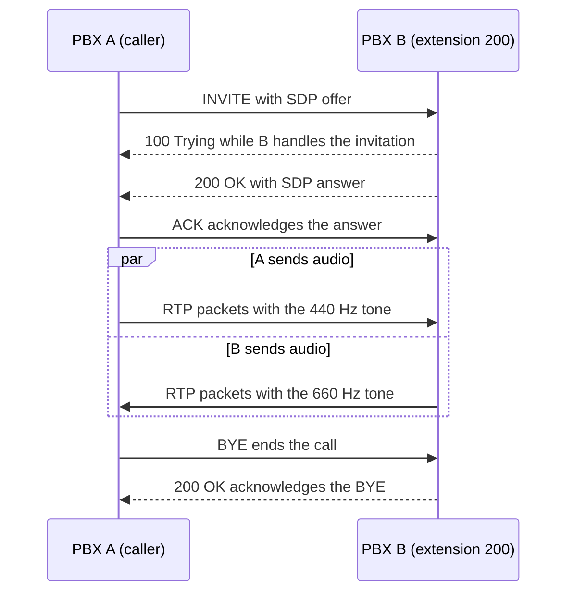

# Asterisk Trunk with TLS and SRTP Support

**VŠB–TUO · VoIP I learning lab**

Read Daniel Alves’s [published semester project](https://dalvelac.github.io/asterisk-trunk-tls-srtp/) or open [the local website](site/index.html). In the full project tree, the [handoff](HANDOFF.md) maps the assignment to the evidence and gives preview, publishing and presentation instructions. Use the [experiment guide](experiment/REPRODUCE.md) to reproduce the six measured calls or recalculate their results. The quick start below uses the original short learning call.

**Asterisk** is software that can act as a telephone exchange, also called a **PBX** (private branch exchange). This lab runs two exchanges, A and B, on one computer. A **trunk** is the connection configured between them so that one exchange can send calls to the other. Here A dials **extension 200** on B. B has a rule to answer that number automatically. A sends a 440 Hz tone and B sends a 660 Hz tone, so you can recognize each end without a phone or microphone.

On a first reading, follow the two packets below, then place a call with the quick start. The numbered build and file walkthrough are there for when you want to reproduce or change what you saw.

[Read one call](#read-one-call) · [Quick start](#quick-start) · [Step-by-step build](#build-the-lab-from-scratch) · [Follow the configuration](#follow-the-call-through-the-configuration) · [Capture a call](#capture-the-link-once) · [Exercises](#four-exercises)

## Read one call

**Signaling** is how A asks B to answer, how they agree where to send sound, and how either side hangs up. The exchanges use the Session Initiation Protocol (**SIP**) for these messages. **PJSIP** is the SIP software Asterisk uses. Inside its invitation, A includes a Session Description Protocol (**SDP**) *offer* saying “I can receive this audio format at this address and port.” B's *answer* gives A the corresponding details for B. An Internet Protocol (**IP**) address identifies a node on this network. A port is a numbered destination on that node. [SIP call example](https://www.rfc-editor.org/rfc/rfc3261#section-4) · [SDP media description](https://www.rfc-editor.org/rfc/rfc8866#section-5.14)

**Media** is the sound itself. Each exchange encodes a short piece of its tone and sends it to the port the other side advertised, using the Real-time Transport Protocol (**RTP**). Once B answers, both ends can send at the same time. The diagram follows the supplied plaintext call.



The profiles change how these two conversations travel. The Transmission Control Protocol (**TCP**) supplies an ordered stream of bytes and retransmits missing data. The User Datagram Protocol (**UDP**) sends independent packets without waiting for missing ones to be retransmitted. Both profiles use TCP for signaling and UDP for time-sensitive audio, so switching on encryption keeps those underlying transports the same.

| Profile | How the call is set up | How the tones travel |
|---|---|---|
| `plain` | SIP messages are readable on the TCP connection. | RTP carries audio that Wireshark can play. |
| `secure` | Transport Layer Security (**TLS**) authenticates the peers and encrypts SIP on the TCP connection. | Secure RTP (**SRTP**) encrypts the audio and authenticates each media packet. |

**Try this before building anything.** In Wireshark choose **File → Open** and select `smoke/plain.pcap`. A **pcap** is a recording of the packets seen by a network interface. Enter `frame.number == 8 || frame.number == 11` in the display filter bar. You can now connect something B *said* to something A *did*. [Saved plaintext call](smoke/plain.pcap)

1. Select **frame 8**, B’s answer. Expand **Session Initiation Protocol → Message Body → Session Description Protocol**. The line `m=audio 10016 RTP/AVP 0` tells A that B receives audio on port **10016**. Format **0** means G.711 µ-law audio here. The `200` in `200 OK` is a success code. The dialed extension appears in the earlier INVITE.
2. Select **frame 11**, an audio packet from A. Expand **User Datagram Protocol**. Its destination port is **10016**, exactly the number B advertised. Clear the filter to see both directions. Your own call can choose different audio ports.

Use these terms as an index when you return to your course notes.

| Topic in your notes | Where you can check it in the lab |
|---|---|
| Extensions and call routing | Read `200@from-peer` as “number 200 in the rules for incoming trunk calls.” Follow it to `Answer()` in the [dialplan](starter/common/extensions.conf). |
| Sampling, codecs and packetization | A **codec** represents sound as data. Look for `PCMU/8000` and `ptime:20` in frame 8, then check the spacing in audio samples using the [RTP timestamps](#read-the-signaling-and-the-audio-separately). |
| Peer authentication and encryption | Follow how TLS checks the peer and protects the SIP conversation, then how SRTP protects the audio datagrams. [Secure profile walkthrough](#what-the-secure-profile-checks) |
| Bandwidth and protocol overhead | Follow the same two flows separately when you count IP bytes during setup and during steady audio. [Measurement worksheet](#calculate-an-ip-layer-rate) |

## Quick start

Run these commands in a terminal on your own computer (the **host**), in the directory containing this README. `./lab` runs the Python launcher in this folder. `up plain` starts the two exchanges and `call` asks Asterisk on A to dial B.

```sh
./lab up plain
./lab call
```

Look for **“Answered on both peers”** followed by one SIP **Call-ID**. Both PBXs saw that identifier in the same SIP conversation. Each PBX output line describes a **channel**, its local side of the call. On A’s line, `remote` is B’s audio destination, `tx` counts media packets A sent, and `rx` counts those A received. Positive counts on **both** lines show two-way traffic at the time of the check. The command returns after both channels hang up, about 12 seconds after answer. To hear the tones, open a plaintext capture in Wireshark’s RTP Player. [Find and play the audio](#read-the-signaling-and-the-audio-separately)

This Artix workstation has a private rootless Docker engine and a cached PBX image under your user cache. On a fresh machine, use Linux, macOS, or WSL2 with Python 3.8+, OpenSSL 3 or later, and a running Docker Engine or Desktop using Linux containers and the Compose plugin with `up --wait`. The image supports amd64 and arm64. The first build needs internet access. Both containers include tcpdump. Use Wireshark for graphical inspection and playback, or TShark for the command-line exercises.

| What you want to do | Command |
|---|---|
| Start fresh TCP + RTP peers | `./lab up plain` |
| Switch both peers to TLS + required SRTP | `./lab up secure` |
| Place and check one call in the active mode | `./lab call` |
| Check both builds, transports and endpoint policies | `./lab status` |
| Open A’s or B’s command-line interface (CLI) | `./lab cli a` or `./lab cli b` (type `exit` to leave) |
| Apply edits and start fresh connections in the same mode | `./lab restart` |
| Stop both servers and remove their private bridge | `./lab down` |
| Restore the starter files and stop | `./lab reset`, then `./lab up plain` to start |

Edit **`work/common/`** and **`work/profiles/`**. The launcher creates these from `starter/` on first use. Starting or switching a profile recreates both containers and ends any active call. Copy a capture out of the container before switching. Files under `captures/` on the host survive every command above. Reset saves your edited tree under `.lab/backups/` and removes the old lab identities. The next start issues fresh certificates. After editing the Dockerfile or container startup script, run `./lab compose build pbx-a` and `./lab restart` to use the rebuilt image on both peers.

`./lab compose` passes commands through to Docker Compose and can select this workstation’s private Docker client. In `./lab compose exec -T pbx-a asterisk -rx 'core show version'`, `exec -T` runs a command **inside A** without opening an interactive terminal, and `asterisk -rx` sends that one command to the running exchange. For several commands, use `./lab cli a`. A prompt ending in `*CLI>` accepts Asterisk commands. Type `exit` to return to the host shell. Wireshark display filters go in Wireshark’s filter bar.

## Build the lab from scratch

These steps take the supplied source files through to an answered call in each mode. They expose the image build, configuration, certificate issuance, and Compose commands that `./lab up` normally runs for you. Use one lab directory per Docker engine. The two services share the project name `vsb-voip-lab` and a fixed subnet.

### 1. Open the project directory

On the prepared workstation, open a terminal and run the following. `cd` puts you in the folder that contains the launcher and configuration. Adding `.lab/bin` to `PATH` lets this terminal find the workstation's Docker and capture tools. Then go to step 2.

```sh
cd "$HOME/Desktop/Universidad/VoIP"
export PATH="$PWD/.lab/bin:$PATH"
```

**To build on another computer**, pack the portable files from the directory containing this README. The archive lists the source templates and example captures explicitly. Your editable copy and private keys stay on this computer. The other installation creates its own.

```sh
tar -czf /tmp/voip-lab-src.tar.gz README.md lab compose.yaml docker scripts starter smoke .gitignore
```

Copy that archive into the destination machine’s `~/Downloads/`. Extract it into a fresh directory and run the rest of the steps there.

```sh
mkdir -p "$HOME/voip-lab"
tar -xzf "$HOME/Downloads/voip-lab-src.tar.gz" -C "$HOME/voip-lab"
cd "$HOME/voip-lab"
```

### 2. Prepare the host tools

Docker runs each exchange in a separate **container**, with its own running Asterisk process and network address. Compose reads `compose.yaml` to create the two containers and their private network together. Python runs the `./lab` shortcuts, and OpenSSL creates and checks the identities for TLS. For the packet exercises, tcpdump records traffic inside A. Wireshark opens the file on your host, and TShark reads the same file from a terminal.

**On the prepared workstation**, go straight to the version checks below. **On a fresh Artix Linux machine using OpenRC**, the following commands install the system Docker service, build tools, Python, OpenSSL and Wireshark. The `wireshark-qt` package also installs TShark. [Artix Docker service package](https://packages.artixlinux.org/packages/world/any/docker-openrc/)

```sh
sudo pacman -Syu --needed docker docker-openrc docker-compose docker-buildx python openssl wireshark-qt
sudo rc-service docker start
```

For a system Docker installation, the account running `./lab` needs access to the daemon. On your own machine, if you choose Docker group access, run `sudo usermod -aG docker "$(id -un)"`, sign out and back in, and return to the project directory. Membership grants root-level control of the host. The prepared workstation uses rootless Docker. [Docker account access](https://docs.docker.com/engine/install/linux-postinstall/#manage-docker-as-a-non-root-user)

On another Linux distribution, install the Engine and Compose plugin for that distribution. On macOS, start Docker Desktop. On Windows, enable Docker Desktop’s WSL integration and run the lab commands inside your WSL2 distribution. [Docker Engine installation](https://docs.docker.com/engine/install/) · [Docker Desktop for Mac](https://docs.docker.com/desktop/setup/install/mac-install/) · [WSL2 integration](https://docs.docker.com/desktop/features/wsl/)

Run these as the user who will place calls. A Docker **server** version means your terminal can reach the engine that starts containers. Look for `--wait` and `--wait-timeout` in Compose's help, since the launcher uses them to wait for both PBXs to start.

```sh
python3 --version
openssl version
docker version --format 'Docker server {{.Server.Version}}'
docker compose version
docker compose up --help | grep -- '--wait'
```

### 3. Build the shared Asterisk image

An **image** is the package of programs and files used to start a container. A and B start from the same image so a difference between software versions cannot affect your comparison. The Dockerfile selects an exact upstream Asterisk build by its SHA-256 digest, installs tcpdump, and checks the Asterisk version and the PJSIP and SRTP module files. A module adds a capability to the running exchange. [Dockerfile](docker/Dockerfile) · [Compose file](compose.yaml)

```sh
docker compose config --quiet
docker compose build pbx-a
docker run --rm --network none --entrypoint /usr/sbin/asterisk vsb-voip-lab:22.8-cert5 -V
```

The first command checks that Compose can read the configuration. The second creates the local image shared by A and B. The third starts a temporary container with networking disabled, runs only the version command, then removes that container. It should print `Asterisk certified-22.8-cert5`. Step 6 checks which modules actually loaded in the running PBXs.

### 4. Assemble the trunk, routing and media configuration

Create the working copy once. The guard below preserves an existing `work/` directory. Make your changes there and keep `starter/` as the copy that `./lab reset` restores.

```sh
if [ ! -d work ]; then cp -R starter work; fi
ls work/common work/profiles
```

| File in the build | What it controls and why |
|---|---|
| `compose.yaml` | Creates a private virtual network, called a bridge. A has address `172.30.76.10`, and B has `172.30.76.11`. Fixed IPs make packets easy to recognize. Docker's internal Domain Name System (DNS) lets each PBX find the other by a name that also appears on its certificate. No ports are published to the LAN. |
| `work/common/pjsip.conf` | Describes how to treat the other PBX. Both modes allow only G.711 µ-law, request 20 ms audio packets with `allow=ulaw:20` and `use_ptime=yes`, and keep Asterisk in the media path with `direct_media=no`. These shared settings keep the call comparable. |
| `work/profiles/plain.conf` and `secure.conf` | Select the signaling transport, the address to dial and the audio protection. The secure profile requires SRTP. You can switch both PBXs without rewriting their routing rules or tone settings. |
| `work/common/extensions.conf` | The **dialplan** gives Asterisk instructions for a dialed number. Here it answers 200, chooses a tone for each end, keeps the call open and hangs up. Change this file to experiment with what a caller hears. |
| `work/common/rtp.conf` | Gives both PBXs the UDP port range 10000–10039. Each chooses an even port for audio. The adjacent odd port carries RTP Control Protocol (RTCP) reports about the stream. The `rtcpinterval=5000` setting requests a report about every five seconds, explaining the second, quieter UDP flow. |
| `work/common/modules.conf`, `logger.conf`, `http.conf`, `manager.conf` | An explicit module list makes Asterisk stop at startup if a required capability fails to load. Notices, warnings and errors go to the console. The CLI connects through a local control socket, so the web and manager listeners are disabled. Leaving raw SIP logging off keeps secure call keys out of the console. |

Compose makes `work/` available read-only inside both containers at `/lab`. At startup, `docker/start` copies the common files into `/etc/asterisk/`, substitutes the local and peer addresses for `@LOCAL_IP@`, `@PEER_IP@` and `@PEER_NAME@`, and writes the selected profile as `link.conf`. The line `#include link.conf` in `pjsip.conf` makes Asterisk read it. Thus “peer” means B on A and A on B, even though you edit one set of files. Run `./lab restart` after an edit to regenerate both running configurations. [Startup script](docker/start) · [Starter configuration](starter/)

When editing the static contact, keep the escaped semicolon in `contact=sip:@PEER_NAME@:5061\;transport=tls`. A semicolon usually starts a comment in an Asterisk file. The backslash makes it part of the SIP address, so the transport selection reaches PJSIP. [Plain profile](starter/profiles/plain.conf) · [Secure profile](starter/profiles/secure.conf)

<details>
<summary>How to read the smaller settings in the configuration files</summary>

- `disallow=all` starts with an empty codec list. The following `allow=ulaw:20` gives both nodes a single choice. G.711's fixed number of bytes per sample makes it easy to check packetization yourself.
- `media_address` is the address Asterisk puts in its SDP. `bind_rtp_to_media_address=yes` also sends the audio from that address. Both nodes are directly reachable on the private bridge, so `ice_support=no` disables ICE, a way to discover a working network path. [Asterisk endpoint options](https://docs.asterisk.org/Certified-Asterisk_22.8_Documentation/API_Documentation/Module_Configuration/res_pjsip/#bind_rtp_to_media_address)
- `dtmf_mode=none` disables telephone keypad events. The experiment sends continuous tones. `qualify_frequency=0` disables periodic SIP reachability probes, so a probe cannot open the TCP or TLS connection before you start your call capture.
- `strictrtp=yes` makes the receiver learn the media source and check subsequent packets against it. The secure profile adds cryptographic authentication of SRTP packets. A check on the source address alone cannot supply that protection.

</details>

### 5. Issue and verify the lab certificates

Each exchange needs a way to recognize the other when it opens a TLS connection. The script creates a local **certificate authority (CA)**. Its signature on a node's **certificate** vouches for the association between a name, such as `pbx-b.lab.test`, and a public key. B keeps the matching **private key** and uses it to prove its identity during the handshake. Both exchanges are configured to trust this lab's CA directly.

Create the private state directory and run the issuer once. Mode `700` gives only your account access to the new directory. The script signs both certificates, discards the CA signing key, and leaves one identity directory per node. Repeating the guarded command reuses the pair. [Certificate script](scripts/make-certs)

```sh
mkdir -p -m 700 .lab
if [ ! -d .lab/pki ]; then sh scripts/make-certs "$PWD/.lab"; fi
for node in a b; do
  dir=".lab/pki/$node"
  openssl verify -CAfile "$dir/ca.crt" -purpose sslserver \
    -verify_hostname "pbx-$node.lab.test" "$dir/node.crt"
  openssl verify -CAfile "$dir/ca.crt" -purpose sslclient "$dir/node.crt"
done
```

Expect two `OK` results per node from the loop. The first checks the CA signature chain, certificate validity, server usage and expected DNS name. The second checks suitability for client authentication using the same CA. Both roles matter because either PBX can initiate a connection. These are offline checks on the files. The first secure call tests the running peers. Compose mounts only a node's own directory as `/identity`. On secure startup the node copies its certificate, private key and the public CA certificate into `/run/asterisk/tls/`, readable by the Asterisk service account.

### 6. Bring up the plaintext pair and place a call

The two mode settings below have different readers. The launcher reads `.lab/mode` to know what protection to expect when it checks a call. Compose passes `LAB_MODE` to both servers so each loads the corresponding profile. Set them both to `plain` for this step.

```sh
printf '%s\n' plain > .lab/mode
LAB_MODE=plain docker compose up -d --no-build --pull never --wait --wait-timeout 65
./lab status
./lab call
```

`-d` runs both PBXs in the background. `--no-build --pull never` selects the image you just built. `--wait` returns once each PBX lists the configured transport and peer endpoint. That health check can pass before either PBX has ever dialed the other.

Compare the next two commands. `./lab status` should show `link` on TCP/5060, running PJSIP and SRTP modules, and `PJ_HAS_SSL_SOCK : 1` (the SIP library supports TLS). `./lab call` shows the **actual call** with a shared SIP Call-ID, `tls=0 srtp=0`, `codec=(ulaw)` and positive send and receive counts on both peers. This is how you can tell which of the installed capabilities the call used.

### 7. Switch to secure mode and check it end to end

After the plaintext call ends, recreate the pair to load the new transport and open a fresh connection. `down --volumes` removes the containers, their disposable volumes and the private network. Your working configuration and certificates live in host directories and carry over to the next start. Copy any capture in a container's `/tmp` to the host first.

```sh
docker compose down --volumes
printf '%s\n' secure > .lab/mode
LAB_MODE=secure docker compose up -d --no-build --pull never --wait --wait-timeout 65
./lab status
./lab call
```

Status should now show TLS/5061 and `media_encryption=sdes`. On the answered call look for `tls=1` **and** `srtp=1` on both legs, sharing a Call-ID and carrying media in both directions. The extension, tones, duration and codec come from the same shared files as in step 6. If startup fails, run `./lab compose ps -a` to see which container failed and `./lab compose logs --tail 40 pbx-a pbx-b` to read its error. If both start but B fails to answer, check B’s route with `./lab compose exec -T pbx-b asterisk -rx 'dialplan show 200@from-peer'`.

For subsequent sessions, `./lab up plain` or `./lab up secure` performs the setup automatically. To save your own packet evidence, start tcpdump before dialing the next call. To finish the session, run `./lab down`. [Capture instructions](#capture-the-link-once) · [Switching, editing and reset commands](#quick-start)

## Follow the call through the configuration

| On the internal bridge | PBX A | PBX B |
|---|---|---|
| DNS name | `pbx-a.lab.test` | `pbx-b.lab.test` |
| Address | `172.30.76.10` | `172.30.76.11` |
| Active SIP listener | TCP 5060 or TLS 5061 | TCP 5060 or TLS 5061 |
| Media | UDP 10000–10039 | UDP 10000–10039 |

The two services attach only to `vsb-voip-lab_trunk`, an internal bridge on `172.30.76.0/28`. Compose publishes zero host ports. Use `./lab compose ps` to check the empty PORTS column. The build pulls software before either PBX joins this network. [Compose topology](compose.yaml) · [Docker internal networks](https://docs.docker.com/reference/compose-file/networks/#internal)

1. **A calls extension 200 on B.** In the command below, read `PJSIP/200@peer` as “use the PJSIP driver to dial 200 through the trunk named peer.” The part after `extension` tells **A** what to do when B answers. Here `101@caller-tone` runs A's tone instructions locally. Only `200` is dialed on B. The launcher uses a fresh local number in place of `101` so it can find this attempt in A’s logs.

   ```sh
   ./lab compose exec -T pbx-a asterisk -rx 'channel originate PJSIP/200@peer extension 101@caller-tone'
   ```

2. **A finds B, and B recognizes A.** Read the two running files together with `./lab compose exec -T pbx-a cat /etc/asterisk/pjsip.conf /etc/asterisk/link.conf`. PJSIP splits a trunk into objects. You can follow the references as an outgoing call moves from the endpoint to a network address. [Asterisk's guide to PJSIP objects](https://docs.asterisk.org/Configuration/Channel-Drivers/SIP/Configuring-res_pjsip/PJSIP-Configuration-Sections-and-Relationships/)

   | Object to find | Question it answers in this call |
   |---|---|
   | `[peer]`, `type=endpoint` | **How do I handle this peer?** The endpoint sets codec and routing rules. In `[peer](media-policy)`, the parentheses tell Asterisk to inherit the active profile’s media settings. |
   | `aors=peer` → `[peer]`, `type=aor` | **Where do I send the invitation?** The address of record (AoR) holds a fixed contact with B’s DNS name and signaling port. The two `[peer]` sections have different types. A already knows B’s contact, so B can receive this call without registering first. |
   | `transport=link` → `[link]`, `type=transport` | **How do SIP messages travel?** The transport configures the network protocol and the local address and port to listen on. Both ends select the same profile. |
   | `[only-peer]`, `type=identify` | **Whose incoming call is this?** B matches the packet's source IP to endpoint `peer`. The `/32` means exactly A's IPv4 address. The endpoint's `context=from-peer` then sends the call to the rules for incoming trunk calls. |

3. **B answers and both ends generate audio.** In the dialplan, a **context** is a named group of routing instructions. Read `exten => 200,1,Answer()` in `[from-peer]` as “for 200, the first action is answer.” Each `same => n` is the next action for that extension. B sets its tone to 660 Hz, while A's `[caller-tone]` sets 440 Hz. Both then execute `Goto(tones,s,1)`, meaning “go to context tones, extension s, step 1.” There `PlayTones` starts the tone generator and `Wait` leaves it running while packets travel both ways. Each PBX generates and receives audio itself. With `direct_media=no` the trunk also keeps Asterisk in the media path. [Dialplan](starter/common/extensions.conf) · [RTP settings](starter/common/rtp.conf)

4. **Watch the call and its hangup.** After two seconds each PBX logs one `LAB-MEDIA` line. A's `remote` is **B’s** listening address and port, and vice versa. The launcher finds A’s local run number, reads its SIP Call-ID, then looks for that same ID on B. Try `pjsip show channelstats` in either CLI while the tones play. After ten more seconds the dialplan reaches `Hangup()` and the launcher waits for both channels to disappear. You can still retrieve their readings with `./lab compose logs --no-color pbx-a pbx-b | grep LAB-MEDIA`.

Open either **command-line interface (CLI)** with `./lab cli a` or `./lab cli b` and use these commands to answer specific questions.

| What are you checking? | Asterisk CLI command | What to look for |
|---|---|---|
| Which software is running? | `core show version` | Both PBXs should report `certified-22.8-cert5`. |
| Can the exchange handle SIP, TLS and SRTP? | `module show like chan_pjsip.so`, `pjproject show buildopts`, `module show like res_srtp.so` | Run each command separately. Look for `Running` for each module and `PJ_HAS_SSL_SOCK : 1` in the build options. |
| What is my configured policy? | `pjsip show endpoint peer` | Check the allowed codec, `direct_media` and `media_encryption`. |
| Where does this exchange listen and where will it dial? | `pjsip show transport link`, then `pjsip show aor peer` | The transport shows the **local** listener. The AoR contact shows the **remote** address. `NonQual` means the lab has disabled periodic SIP OPTIONS reachability probes. |
| What will an incoming 200 call do? | `dialplan show 200@from-peer` | On B, find `Answer()` and the jump to the tone instructions. |
| Is there a call right now? | `core show channels` | Look during the call for `PJSIP/peer-…`. After hangup the channel disappears. |

## What the secure profile checks

**First the exchanges authenticate each other.** A opens a TCP connection to `pbx-b.lab.test:5061`. Before sending the SIP invitation, the two sides perform a TLS *handshake* to check identities and establish encryption for that connection. The secure profile pins TLS 1.2. You can see both certificates and the certificate request in this handshake. Each side proves possession of its private key without sending that key. [Secure profile](starter/profiles/secure.conf)

| Who is checking? | Which rule do they apply? |
|---|---|
| **A checks B**, the TLS server | With `verify_server=yes`, A checks the certificate chain against the lab CA, checks its validity, and matches the DNS name A dialed to a name on B's certificate. |
| **B checks A**, the TLS client | `require_client_cert=yes` makes a client certificate mandatory, and `verify_client=yes` requires it to validate against the lab CA. B accepts a valid client identity from that CA. Once SIP arrives, its separate `identify` rule maps A's exact source IP to endpoint `peer`. |

You can read B's **public** certificate with `openssl x509 -in .lab/pki/b/node.crt -noout -subject -dates -ext subjectAltName`. Find `pbx-b.lab.test` under *Subject Alternative Name*, the list of identities the certificate covers. Compare it to A's AoR contact. Both certificates cover the node's DNS name and IP and permit server and client use, since the connection roles reverse if B dials. The node certificates last 30 days. Use `./lab reset` and then `./lab up secure` to issue a fresh pair. [Certificate script](scripts/make-certs) · [Asterisk transport options](https://docs.asterisk.org/Certified-Asterisk_22.8_Documentation/API_Documentation/Module_Configuration/res_pjsip/) · [PJSIP TLS identity checks](https://docs.pjsip.org/en/latest/specific-guides/security/ssl.html)

**Then the call negotiates media protection.** The endpoint requires SRTP with `media_encryption=sdes` and `media_encryption_optimistic=no`. Asterisk rejects an offer of plain RTP alone. The lab uses **SDES** (SDP Security Descriptions) so the same offer and answer that choose the UDP ports also carry the keys for each direction’s audio. TLS encrypts those messages on the inter-server link. The certificate private keys prove identity during the handshake. The negotiated media keys encrypt the audio payload and authenticate the SRTP packets sent over UDP. [SDP Security Descriptions](https://www.rfc-editor.org/rfc/rfc4568#section-4) · [SRTP packet format](https://www.rfc-editor.org/rfc/rfc3711#section-3.1)

**Check the result without exposing keys.** The dialplan reads `CHANNEL(pjsip,secure)` for the active signaling connection and `CHANNEL(rtp,secure,audio)` for the negotiated audio stream. These produce the `tls` and `srtp` flags in `LAB-MEDIA`. Use those lines and the encrypted wire capture for screenshots. A SIP trace *inside* Asterisk can see SDP after TLS decryption and could print its keys. Keep the raw SIP logger, history and debug logging off in secure mode. [Asterisk CHANNEL function](https://docs.asterisk.org/Certified-Asterisk_22.8_Documentation/API_Documentation/Dialplan_Functions/CHANNEL/)

To try the certificate check by itself, run this **after** finishing your secure call capture. OpenSSL opens a separate TLS connection from A without placing a call. Doing this after capture keeps the extra handshake out of your call file.

```sh
./lab compose exec -T pbx-a openssl s_client -brief -tls1_2 \
  -connect pbx-b.lab.test:5061 -servername pbx-b.lab.test \
  -verify_hostname pbx-b.lab.test -verify_return_error -CAfile /identity/ca.crt \
  -cert /identity/node.crt -key /identity/node.key </dev/null
```

`-connect` chooses the destination. `-servername` tells the listener which DNS name A wants, while `-verify_hostname` actually checks that name against B’s certificate. `-CAfile` supplies the trusted CA and `-cert` and `-key` let A prove its identity to B. Look for `Verification: OK`. Repeat with the `-cert` and `-key` arguments removed. B should now reject the handshake because A has presented no client identity. Keep `</dev/null` so the terminal sends no further input.

## Capture the link once

**In terminal 1**, choose a mode and start fresh peers before recording. SIP can reuse an open TCP or TLS connection across calls. A fresh start lets you capture the initial connection and any handshake. Run tcpdump **inside A, on eth0 only**. `eth0` is A’s network interface on the virtual bridge. Both its outgoing and incoming packets pass there once. Combining traces from both PBXs would count the same exchange twice.

```sh
MODE=plain                       # use MODE=secure for the other capture
./lab up "$MODE"
mkdir -p captures
./lab compose exec pbx-a tcpdump -p -ni eth0 -s 0 -U -w "/tmp/$MODE.pcap" \
  'ip and host 172.30.76.10 and host 172.30.76.11 and (tcp or udp)'
```

The quoted **capture filter** saves only IPv4 TCP or UDP packets between the two PBXs. Here `-p` keeps the interface in its normal mode, `-n` uses numeric addresses, `-i eth0` picks the interface, `-s 0` requests full packets, `-U` flushes each packet to the file, and `-w` names the output file inside A.

**In terminal 2**, from the same lab directory, run `./lab call` after tcpdump prints `listening on eth0`. Record the Call-ID and both `remote` ports. Wait for `Both legs hung up`, then press **Ctrl+C in terminal 1**. Check tcpdump’s dropped-packet count. Back in terminal 1, copy the recording from A to your host and open it. On the prepared workstation, `export PATH="$PWD/.lab/bin:$PATH"` makes Wireshark and TShark available in the host terminal.

```sh
./lab compose cp "pbx-a:/tmp/$MODE.pcap" "captures/$MODE.pcap"
wireshark "captures/$MODE.pcap"
```

Repeat the full recipe with `MODE=secure` to get `captures/secure.pcap`. The filenames above are reused on a rerun. Choose a new host filename to keep another trial. The **display filters** below change which saved packets Wireshark shows. Clear the filter to see the full capture again.

### Read the signaling and the audio separately

| Where to look | Plain call | Secure call |
|---|---|---|
| Signaling TCP conversation | Filter `sip` or `tcp.port == 5060`. Follow INVITE → final 200 OK → ACK, then BYE → 200 OK. Match the Call-ID. In SDP, inspect the audio port, `RTP/AVP`, PCMU and `ptime`. | Filter `tcp.port == 5061 && tls`. Find ClientHello, ServerHello, the certificate exchange and application-data records. Correlate the stream with the call time, peer IPs and the live `tls=1` readings. |
| Audio UDP conversation | Open **Telephony → RTP → RTP Streams**, select the row sourced by A, choose **Play Streams** and press Play. Repeat with B's row to hear the other tone. [Wireshark RTP Player](https://www.wireshark.org/docs/wsug_html_chunked/ChTelRTP.html) | Use the same call’s two `remote` addresses and ports to find the UDP flow. Both legs should report `srtp=1`, positive media counters and the far PBX as their destination. The RTP header remains visible on SRTP packets. |

For example, the display filter `udp.port == 10024 && udp.port == 10016` shows packets between the two audio ports in the saved plaintext call. The `&&` requires both port numbers to match the same packet, in either direction. Substitute the two ports from your own call when reading your capture.

The TLS handshake followed by encrypted application-data records identifies protected signaling on that TCP connection. The tones travel on a separate UDP port pair. In `./lab call`, read the `srtp` flag on **both** PBXs and match their `remote` addresses and ports to the flowing UDP packets. This connects Asterisk's record of the negotiation to the traffic for that call. A readable RTP header is consistent with SRTP because SRTP still exposes the sequence number and timestamp. Packet sizes or noise in a player cannot identify which protection was negotiated. [SRTP packet format](https://www.rfc-editor.org/rfc/rfc3711#section-3.1) · [Wireshark telephony guide](https://www.wireshark.org/docs/wsug_html/#ChTelephony)

**Check actual packetization.** Packetization is how much sound goes in one packet. G.711 µ-law (`PCMU` on the wire, `ulaw` in Asterisk) encodes 8,000 samples per second at one byte per sample. The intended 20 ms represents `8000 × 0.020 = 160` samples. In plain SDP, `a=ptime:20` tells you what was requested. The following check measures the sound the sender actually put into successive packets. [RTP audio profile and clock rates](https://www.rfc-editor.org/rfc/rfc3551#section-6)

1. Pick one steady stream. Its **SSRC** (synchronization source identifier) groups packets from that sender. Use one SSRC at a time since each sender has its own numbering and clock.
2. Find two packets with consecutive **sequence numbers**. Expand **Real-Time Transport Protocol** and read their **timestamps**. The sequence number counts packets. The timestamp marks the first audio sample in a packet, in units of the sender's 8,000 Hz clock.
3. Subtract the earlier timestamp from the later one. Compute `1000 × difference / 8000` milliseconds. A difference of 160 ticks means 20 ms of sound. Repeat for several pairs in each direction. Network scheduling can make packet *arrival* times uneven even when their audio durations match. [RTP header fields](https://www.rfc-editor.org/rfc/rfc3550#section-5.1)

For secure traffic, TLS hides the SDP that Wireshark normally uses to discover the ports. Use **Analyze → Decode As… → RTP** for an observed audio UDP port to examine the header. This changes the interpretation in the viewer and leaves the audio encrypted. RTCP (RTP Control Protocol) sends periodic stream reports on the adjacent odd port in this lab. Its secure form is SRTCP. The following TShark command prints just the time, sender and RTP header fields from your secure capture.

```sh
printf 'A audio port (from pbx-b remote): '; read -r APORT
tshark -n -r captures/secure.pcap -d "udp.port==$APORT,rtp" -Y 'rtp.p_type == 0' \
  -T fields -e frame.time_relative -e ip.src -e rtp.ssrc -e rtp.seq -e rtp.timestamp | head -30
```

## Starter smoke checks

A **smoke check** is a short call to verify that the setup works. The step-by-step build was verified from a clean source archive on Linux amd64 with rootless Docker 28.5.2 and Compose 2.40.3. Both call modes passed. To repeat the call checks, use `./lab up plain`, `./lab status`, `./lab call`, then repeat those commands with `./lab up secure`. The saved starter captures below come from A’s eth0. Their Call-IDs and ports belong to these individual calls.

| Build check | Observed evidence |
|---|---|
| Plain trunk | Both `PJSIP/peer` legs reported Call-ID `4ae1c5b9-eec9-4ab0-9ed5-1733022f1575`, `tls=0`, `srtp=0`, `(ulaw)` and positive TX/RX. Frames 4, 8 and 10 show INVITE, 200 OK and ACK. SDP identified A:10024 and B:10016. [Plain smoke capture](smoke/plain.pcap) |
| Secure trunk | Both legs reported Call-ID `1e0e4464-aa26-4fdc-ab9f-e5a1f431d138`, `tls=1`, `srtp=1`, `(ulaw)` and positive TX/RX. Frames 4, 6 and 8 show the TLS handshake, including B requesting a certificate and A sending one. TLS application data followed. UDP flowed between A:10032 and B:10030. [Secure smoke capture](smoke/secure.pcap) |
| Packetization | Consecutive PT 0 audio packets advanced by 160 ticks on both SSRCs in each capture. |
| Certificate enforcement | A logged successful verification for `pbx-b.lab.test`. The separate OpenSSL check reported TLS 1.2 and `Verification: OK` with A’s identity. B returned a handshake-failure alert when A omitted the client certificate. |

You can read the saved signaling frames directly with TShark, even with both PBXs stopped. In the plaintext output, look for the invitation and its reply sharing a Call-ID. In the secure output, handshake types `1` and `2` are ClientHello and ServerHello, and TLS record content type `23` is application data.

```sh
tshark -n -r smoke/plain.pcap -Y sip -T fields \
  -e frame.number -e ip.src -e sip.Method -e sip.Status-Code -e sip.Call-ID
tshark -n -r smoke/secure.pcap -d tcp.port==5061,tls -Y tls -T fields \
  -e frame.number -e ip.src -e tls.handshake.type -e tls.record.content_type
```

## Calculate an IP-layer rate

The exchange opens a connection at the beginning. It then sends audio packets repeatedly. Switching profiles changes both signaling and media protection, so a whole-call total mixes two effects. Measure setup and steady audio separately to see where the bytes traveled. Keeping the codec, packetization, tones and observation point fixed makes the two captures comparable.

1. **Mark setup.** Set Wireshark’s time display to seconds since the beginning of capture. Record **S**, the time of A's first TCP SYN (the request to open a connection). Select that packet and expand **Transmission Control Protocol → Stream index** to find the stream number you will enter below. Record **M**, the first audio packet time in either direction on the confirmed media port pair. Use the interval `[S, M)`, meaning include the packet at S and stop just before M. Count every IPv4 packet on that TCP stream in the interval, including TCP acknowledgments and, for secure calls, the TLS handshake. These boundaries are visible in both modes. The secure capture hides the exact SIP answer inside TLS.
2. **Mark steady audio.** Use the **same eight-second window** in each call, from `M + 2` up to `M + 10`. Check that both audio streams span it and hangup comes later. Count only the audio UDP port pair. Keep periodic RTCP/SRTCP reports on the adjacent ports out of this calculation. If you also measure those, record them separately using the same rule in both modes.
3. **Turn packet lengths into a rate.** Expand **Internet Protocol Version 4 → Total Length** in a packet. This field, `ip.len`, counts the whole IP packet in bytes, including its headers and payload. Ethernet framing falls outside it. For each sender and window, compute **bit/s = 8 × sum of ip.len / (end time − start time)**. Multiplying by 8 converts bytes to bits. Dividing by the full window duration gives an average rate, including time between packets. Adding A's and B's rates gives the bidirectional total. Record A’s virtual `eth0` as the capture point. Virtual interface offload can group TCP segments there, including during the handshake.

Run this shell function from the lab directory. Set `PCAP` to the file you are analyzing and enter its times and ports. TShark's `-Y` selects the flow and time window. `-T fields` with the two `-e` options prints one sender IP and IP length per packet. The pipe passes those rows to `awk`, which adds up the bytes by sender and divides by the interval you selected.

```sh
export LC_ALL=C                    # enter times in seconds with a decimal point
iprate() {
  tshark -n -r "$PCAP" \
    -Y "($1) && frame.time_relative >= $2 && frame.time_relative < $3" \
    -T fields -e ip.src -e ip.len |
  awk -v start="$2" -v end="$3" '
    NF == 2 { bytes[$1] += $2; total += $2 }
    END {
      if (end <= start || !total) { print "Check the window and filter"; exit 1 }
      for (src in bytes) printf "%s  %d bytes  %.2f bit/s\n", src, bytes[src], 8*bytes[src]/(end-start)
      printf "both  %d bytes  %.2f bit/s\n", total, 8*total/(end-start)
    }'
}

PCAP=captures/plain.pcap          # repeat with captures/secure.pcap
printf 'Setup S and M in seconds, separated by a space: '; read -r S M
printf 'TCP stream index from the SYN: '; read -r STREAM
printf 'Audio ports A and B, separated by a space: '; read -r APORT BPORT
MEDIA="(ip.src == 172.30.76.10 && udp.srcport == $APORT && udp.dstport == $BPORT) || (ip.src == 172.30.76.11 && udp.srcport == $BPORT && udp.dstport == $APORT)"
START=$(awk -v m="$M" 'BEGIN {printf "%.9f", m+2}')
END=$(awk -v m="$M" 'BEGIN {printf "%.9f", m+10}')
iprate "tcp.stream == $STREAM" "$S" "$M"
iprate "$MEDIA" "$START" "$END"
```

## Four exercises

### 1. Trace a plaintext call

**Goal.** Connect an answered SIP dialog to the audio you can hear. **Start** with `MODE=plain` in the capture recipe and `./lab call` in the other terminal. In Wireshark, select the call under **Telephony → VoIP Calls → Flow Sequence**. Inspect the offer and answer, then find the RTP streams.

**Question.** Which frames prove that extension 200 answered, and which address, port and SSRC carry A’s tone?

### 2. Prove signaling and media protection independently

**Goal.** Establish what protects each flow on a particular call. **Start** with `MODE=secure` in the capture recipe. Use `pjsip show transport link` and `pjsip show endpoint peer` for the configured policy, then collect the two live channel readings during `./lab call`.

**Question.** Which TCP frames identify TLS, and which separate channel readings and UDP sockets support your SRTP finding?

### 3. Change one end’s tone

**Goal.** Predict an audible change while holding signaling and packetization constant. **Start** in plain mode. Run `cp work/common/extensions.conf .lab/extensions.before-exercise`, then change only `CALLER_HZ` from `440` to `880` in `work/common/extensions.conf`. Write down which direction you expect to change. Run `./lab restart`, capture a call under a new filename, and play each stream separately. Restore your file with `cp .lab/extensions.before-exercise work/common/extensions.conf`, then run `./lab restart` again.

**Hint.** A sends the caller tone. In the RTP Player, select the SSRC whose source is `172.30.76.10`. If both streams sound unchanged, use `dialplan show globals` in A’s CLI to inspect the running value. **Question.** Which direction changed pitch, and what did its RTP timestamps do?

### 4. Measure two comparable calls

**Goal.** Calculate an IPv4-layer rate for setup and a separate rate for steady audio. **Start** with the restored dialplan and the capture recipe. Make one fresh connection and exactly one call per file. Use the same tone duration, codec, packetization, interface and capture filter. Check for drops and verify the timestamp step before selecting windows. Apply the window definitions and calculation above to each capture.

**Question.** What do your per-direction and combined rates show for setup and steady audio when you apply the same inclusion rules?

| Profile | Setup interval and rates | Steady interval and rates | Your conclusion |
|---|---|---|---|
| Plain | | | |
| Secure | | | |

**Start with `./lab up plain`.** Run `./lab call` and look for a single SIP Call-ID shared by two answered PJSIP legs.
